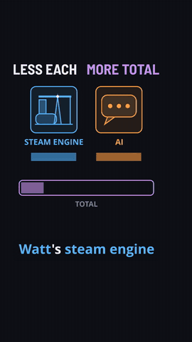
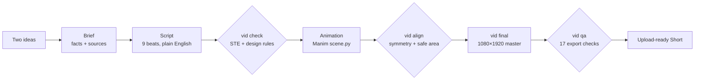

# Same Trick Twice

**Turn a research idea into a 60-second animated explainer, with an AI agent doing the
production.** Each episode takes two things that look unrelated and shows the one trick they
share, in vertical infographic animation with a synthetic narrator. It's a side project and a
fun one. It's also a quick way to see what your own research looks like as a Short.

<p align="center">
  <a href="https://adityasissodiya.github.io/sametricktwice/">
    
  </a>
  <br>
  <b><a href="https://adityasissodiya.github.io/sametricktwice/">▶ Watch Episode 004 with sound</a></b>
  · <a href="exports/004-steam-engine-x-ai.mp4">download the mp4</a>
</p>

**Episode 004, Steam Engine × AI.** Watt's 1769 engine needed less than half the coal, and
Britain's coal output grew more than four times. AI tokens got 200× cheaper, and Google's token use grew 50× in a
year. Both are the *Jevons paradox*: cheaper use brings more use. The video animates that
mechanism once with coal and then replays the same animation with tokens, and that replay is
the moment the idea lands.

## Why it's fun to try with your own research

- **You bring the idea, the agent does the production.** Open the folder in
  [Claude Code](https://claude.com/claude-code) and say *"make an episode about X and Y"*. The
  agent reads [AGENTS.md](AGENTS.md), writes a sourced brief, drafts the script, animates it in
  Manim, renders it and checks it, one step at a time. You review and approve.
- **Every fact needs a source.** The brief keeps a claim ledger, and every spoken beat has to map
  to a sourced row in it. The checks fail if one doesn't.
- **Plain English that keeps the science.** The narration is checked against ASD-STE100
  (Simplified Technical English, the controlled language used in aircraft manuals): at least 80%
  of sentences must pass, and every technical term gets explained the first time it comes up.
  Episode 004 scores 94%.
- **The rules come from research.** Hook within 6 s, mechanism within the first 35%, at most 30
  words per beat, 130–190 words per minute, one colour per meaning. Each rule cites its evidence
  in [RESEARCH.md](RESEARCH.md) and has a test that enforces it.
- **The agent checks the video, not just the code.** It can't watch a video, so the pipeline
  measures one: length, hook timing, speech rate, pauses, caption sync, loudness, motion in the
  opening, sound-cue masking and dead air. It also makes contact sheets at phone size for the
  agent (and you) to look through. Episode 004 passes all 17 export checks.
- **Reproducible and self-contained.** The narrator (Kokoro-82M, open weights) is pinned by
  SHA-256, tools and packages are locked, and every cache stays inside the folder. Nothing is
  installed system-wide.
- **Works on Windows, Linux and macOS.** The same pipeline and the same tests run on all three.

## How it works



Every episode follows the same **nine-beat format**: a hook that names both worlds (B1), world A
(B2), the trick as an animated mechanism (B3), its name (B4), world B (B5), *the same mechanism
replayed* with world B's material (B6), how each side helped the other (B7–B8), and a connection
map that loops back to the start (B9).

Each step has a **gate**, and the agent can't start the next step until it passes. It can't
loosen a limit or skip a check either. `vid status <ep>` shows where an episode stands and the
next thing to do. Here is Episode 004:

```
  [x] 1 Brief      bridge written; 12 ledger rows with sources
  [x] 2 Script     9/9 beats have VO
  [x] 3 Checks     STE 94% (target 80%); design rules: all pass
  [x] 4 Animatic   scene.py exists
  [x] 5 Animation  0 placeholder beat(s) left; vid lint: 0 problem(s)
  [x] 6 Alignment  13 loops, all pass
```

Under the hood: a Manim toolkit (`kit/`) for the house style, captions, sound cues and alignment
checks; a script parser, STE checker, design rules and export QA (`tools/`); and 127 unit tests
(`tests/`).

## Try it: render Episode 004 yourself

You need Git. On Linux and macOS you also need FFmpeg (`sudo apt install ffmpeg`,
`sudo dnf install ffmpeg` or `brew install ffmpeg`); on Windows, setup downloads it for you.

**Linux / macOS**

```sh
git clone https://github.com/adityasissodiya/sametricktwice.git
cd sametricktwice
./vid setup                      # uv, Python 3.12, packages, voice model, tests (~600 MB, all in this folder)
./vid status 004                 # the checklist above
./vid preview 004 --no-open      # a 540x960 render with narration, in media/
```

**Windows** (cmd, or PowerShell with `.\vid`)

```bat
git clone https://github.com/adityasissodiya/sametricktwice.git
cd sametricktwice
vid setup
vid status 004
vid preview 004 --no-open
```

**Make one about your own work.** Open the folder in Claude Code and ask something like:
*"Start a new episode pairing my work on X with Y. Here are my papers."* The agent runs
`vid new`, fills in the brief with your sources and stops for your approval at the script. A
pair works best when one trick, said in one sentence, really does explain both sides.

## Commands

The examples use `vid`. On Linux and macOS, type `./vid`.

```
vid setup                       a new machine: tools, Python, packages, voice model, tests
vid status                      every episode: its current step and the next action
vid status 004                  one episode's full checklist (runs the checks)
vid new 006-film-x-explosives   start the next episode from the templates
vid check 004                   STE score + research-backed design rules
vid lint 004                    carry-over check against earlier episodes
vid preview 004 --guides        render a 540x960 preview with the Shorts UI marked; prints the pace
vid frames 004 --render         contact sheets of every beat + the picture rules of vid qa
vid frames 004 --render --at 14.5 19   frames at chosen seconds (moments the grid misses)
vid align 004                   symmetry guides and the alignment report
vid final 004                   every gate, the 1080x1920 master, then the export QA
vid qa 004                      measure an export: length, hook, pace, captions, loudness
vid report                      YouTube results next to each episode's measurements
vid test                        unit tests
vid ci                          check + lint for every scripted episode
vid doctor                      tools, versions, where caches live, free disk space
vid                             all commands
```

Always render through `vid`. It sets the vertical resolution and keeps every tool and cache
inside this folder.

## The episodes

| # | Pair | The shared trick |
|---|---|---|
| 001 | [Camera × Chip](exports/001-camera-x-chip.mp4) | light hardens a coating: the first photograph and photolithography |
| 002 | [Air Traffic × Touchscreen](exports/002-air-traffic-x-touchscreen.mp4) | a finger changes the charge on a wire |
| 003 | [Atomic Bomb × Non-Stick Pans](exports/003-atomic-bomb-x-non-stick-pans.mp4) | PTFE: nothing can grip a fluorine surface |
| 004 | [Steam Engine × AI](exports/004-steam-engine-x-ai.mp4) | the Jevons paradox: cheaper use brings more use |
| 005 | [Carrots × TV Screens](exports/005-carrots-x-tv-screens.mp4) | liquid crystals |

All five play on the [showcase page](https://adityasissodiya.github.io/sametricktwice/).

## Read more

| Read | For |
|---|---|
| [AGENTS.md](AGENTS.md) | the contract: the work loop, what needs approval, the rules every Short follows |
| [WORKFLOW.md](WORKFLOW.md) | the walkthrough: ten steps from a pair of ideas to the upload and the numbers after it |
| [STYLE_GUIDE.md](STYLE_GUIDE.md) | the visual, motion, caption, sound and alignment language |
| [RESEARCH.md](RESEARCH.md) | why: each rule, its evidence, its limit, the check that enforces it, and what earns money |

Episode 001 (Camera × Chip) is the rendered style reference. Episode 003 (Atomic-Bomb Project ×
Non-Stick Pans) is the reference for the current gates: its scene passes every source,
picture and sound rule, so read it to see narration-relative timing, the shared B3/B6 clock
and layouts that fill the safe stage. Copy principles, never subjects.

## What is where

```
AGENTS.md, CLAUDE.md  agent contract (CLAUDE.md imports AGENTS.md)
WORKFLOW.md           the step-by-step walkthrough and its gates
STYLE_GUIDE.md        Episode 001 house style, visual grammar and the alignment loop
RESEARCH.md           evidence -> rule -> limit -> check; platform economics; open questions
design.toml           limits for the design rules (vid check) and the export QA (vid qa)
ste.toml              STE target (80%) and series-wide glossary
voice.toml            the frozen series narrator: Kokoro af_heart, speed, model checksums
series.toml           the only things episodes may share (vid lint enforces it)
pronounce.toml        how the voice says names (audio only; captions keep the spelling)
ideas/backlog.md      pairs to make, with a scoring rubric and myth traps
templates/            brief.md, script.md, publish.md: copied by `vid new`
episodes/<ep>/        brief.md (facts + sources), script.md (words), scene.py (visuals),
                      publish.md (title, description, upload checklist)
kit/                  Manim toolkit: style, parts, ShortScene, captions, Connection Map,
                      alignment checks, voices; kit/sfx/ holds the house sounds, kit/fonts/
                      the open-licence fonts used where the Windows house fonts are missing
tools/                vid command, script parser, STE check, design rules, carry-over lint,
                      export QA, contact sheets, status tracker, analytics report
tests/                unit tests for every check and kit part (`vid test`)
brand/                channel art (profile picture, banner, watermark) in the house style:
                      `vid uv run python brand/make.py` writes them to exports/brand/
analytics/            results.csv (YouTube numbers you enter), experiments.md, report.md
exports/              finished videos (.mp4), captions (.srt), QA measurements (.qa.json), the
                      channel art (brand/) and replaced masters (archive/<date>/); in git
docs/, index.html     the showcase page (GitHub Pages) and the README preview
media/                Manim renders, voice caches, contact sheets (safe to delete; rebuilt)
vid, vid.cmd          the entry point: vid on Linux and macOS, vid.cmd on Windows
```

`media/`, `.cache/`, `.tools/` and `.venv/` are not in git; `exports/` is, so a clone has every
finished master.

## Everything stays in this folder

`vid` (through `tools/env.sh`) and `vid.cmd` (through `tools/env.cmd`) point every tool at
this folder before it runs, wherever the folder is:

- `.tools/`: portable uv (all platforms), plus FFmpeg, SoX and the GitHub CLI on Windows, plus
  Python 3.12 if the machine has none. Nothing is installed system-wide, registered or added to
  the system PATH. On Linux and macOS, FFmpeg comes from the system package manager.
- `.venv/`: Python packages (Manim, manim-voiceover, spaCy, kokoro-onnx), locked in `uv.lock`.
- `.cache/`: uv's download cache, the Kokoro model, temp files and other caches.

`vid doctor` prints each cache location next to `ok` when it is inside this folder. To add a
package, use `vid uv add <package>` so uv keeps using the folder's cache.

## On a new machine

1. `git clone https://github.com/adityasissodiya/sametricktwice.git` and `cd sametricktwice`.
   The repository is public, so no sign-in is needed to clone it.
2. `vid setup` (`./vid setup` on Linux and macOS). It downloads pinned tools and refuses any
   archive whose SHA-256 differs from the pin (`tools/setup.ps1` on Windows: uv 0.12.23,
   FFmpeg 9.0.2 essentials, SoX 14.4.2, GitHub CLI 2.102.0; `tools/setup.sh` on Linux and
   macOS: uv 0.12.23). It puts CPython 3.12 in `.tools/python` if the machine has none,
   installs the locked packages, fetches the narrator model and checks it against
   `voice.toml`, then prints `vid doctor` and runs `vid test`. About 600 MB of downloads, all
   inside the folder. It is safe to run again.
3. `vid status`, and carry on with the next step it names.

Platform notes:

- **Fonts.** The house fonts (Bahnschrift, Segoe UI) ship with Windows. Elsewhere, `kit/style.py`
  registers the open-licence look-alikes in `kit/fonts/` (Barlow Semi Condensed, Open Sans), so
  a render looks the same without installing anything. The upload masters are made on Windows in
  the house fonts.
- **SoX** is only used to change voice speed, and the series voice runs at 1.0, so the "SoX could
  not be found" warning on Linux and macOS is harmless.
- **`--voice recorder`** (recording your own voice) needs PyAudio, which is installed on Windows
  only. To use it elsewhere, install PortAudio and run `vid uv pip install pyaudio`.

The clone brings `exports/` (finished masters, their captions and QA reports, the channel
art). Git does not carry the licensed research PDF behind `RESEARCH.md` (personal use only,
so it is never committed; copy it across yourself if you want it) or `analytics/report.md`
(`vid report` rebuilds it). Everything in `media/` and `.cache/` is rebuilt when needed; run
`vid align <ep> --no-open` once per episode, because alignment reports live in `media/`.
